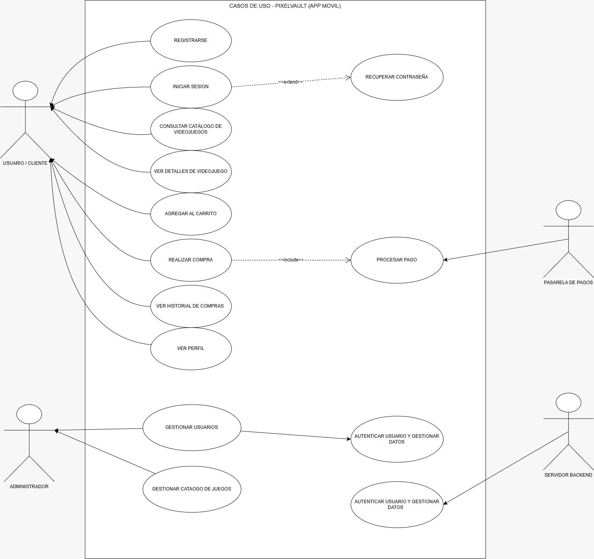

# Diagrama de Casos de Uso - UniRoute

## 1. Representación Visual

El diagrama de casos de uso permite representar las interacciones entre los usuarios y las funcionalidades disponibles en UniRoute.

**Nota:** verifica que la imagen `assets/diagrama_casos_uso.png` corresponda realmente a UniRoute. Si todavía contiene elementos de PixelVault, será necesario actualizarla para que coincida con el proyecto.

## 2. Descripción de Actores y Flujos

### Actores

#### Usuario

Es la persona que utiliza UniRoute para consultar información relacionada con rutas y acceder a las funcionalidades disponibles.

Entre las acciones que puede realizar, según las funciones implementadas, se encuentran:

- Acceder a la aplicación.
- Consultar las opciones disponibles.
- Seleccionar un punto de origen.
- Seleccionar un destino.
- Solicitar información sobre una ruta.
- Consultar los resultados disponibles.
- Revisar las indicaciones del trayecto, si están implementadas.

#### Servicios de Mapas o Ubicación

Estos servicios pueden intervenir cuando la aplicación utiliza herramientas externas para obtener información geográfica, mostrar mapas o determinar ubicaciones.

Su participación debe confirmarse mediante la revisión del código fuente. No se consideran actores confirmados mientras no se verifique que UniRoute utiliza estos servicios.

#### Sistema UniRoute

Representa la aplicación encargada de recibir las acciones del usuario, procesar la información disponible y presentar los resultados de las consultas.

Las operaciones específicas dependen de las funcionalidades implementadas en el proyecto.

---

## 3. Casos de Uso Principales

### Acceder a UniRoute

Permite al usuario abrir la aplicación y acceder a las opciones disponibles.

El sistema presenta la interfaz correspondiente para que el usuario pueda comenzar a utilizar las funcionalidades implementadas.

### Seleccionar Origen

Permite definir el punto desde el cual el usuario desea iniciar un recorrido.

El origen puede seleccionarse mediante los mecanismos disponibles en la aplicación, según su implementación.

### Seleccionar Destino

Permite indicar el lugar al que el usuario desea llegar.

El destino se utiliza junto con el origen para realizar la consulta del trayecto.

### Consultar Información de una Ruta

Permite solicitar información relacionada con un recorrido entre un origen y un destino.

El proceso general puede incluir:

1. Seleccionar el origen.
2. Seleccionar el destino.
3. Solicitar la información de la ruta.
4. Procesar la consulta.
5. Mostrar los resultados disponibles.

La forma de obtener los resultados depende de los mecanismos de consulta utilizados por UniRoute.

### Validar los Datos de la Consulta

Permite comprobar que la información necesaria para realizar una consulta esté disponible.

La aplicación puede verificar que se hayan seleccionado los puntos requeridos antes de procesar la solicitud.

Los controles concretos deben coincidir con los que estén implementados en el proyecto.

### Visualizar los Resultados

Permite al usuario consultar la información obtenida después de solicitar una ruta.

Los resultados pueden incluir datos del recorrido, indicaciones u otra información disponible, de acuerdo con las funciones implementadas.

### Consultar Información Geográfica

Este caso de uso corresponde a la consulta de información geográfica cuando UniRoute dispone de funcionalidades de mapas o ubicación.

La información presentada depende de las fuentes de datos y los servicios que utilice la aplicación.

### Gestionar Errores de Consulta

Permite informar al usuario cuando no es posible completar una consulta.

Entre las situaciones que pueden requerir un mensaje se encuentran la falta de datos necesarios o la ausencia de resultados.

Los mensajes y las condiciones específicas deben verificarse en el código de UniRoute.

---

## 4. Resumen del Flujo Principal

El flujo general de consulta de una ruta en UniRoute puede resumirse de la siguiente manera:

1. El usuario accede a UniRoute.
2. El sistema presenta las opciones disponibles.
3. El usuario selecciona un punto de origen.
4. El usuario selecciona un destino.
5. La aplicación valida los datos necesarios.
6. El usuario solicita información de la ruta.
7. El sistema procesa la consulta.
8. Se obtiene la información disponible.
9. La aplicación presenta los resultados.
10. El usuario revisa la información del recorrido.

Este flujo representa el proceso general de consulta de rutas. Los actores, servicios y pasos definitivos deben coincidir con las funcionalidades que realmente estén implementadas en UniRoute.