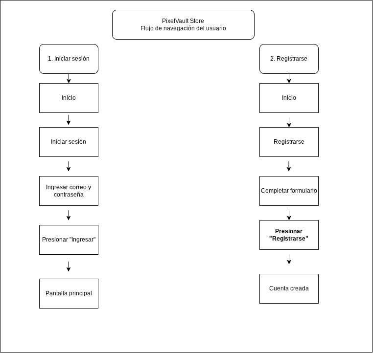
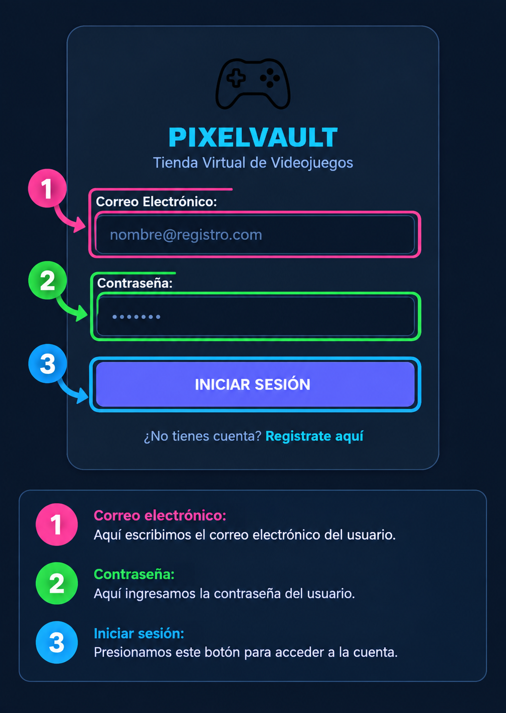
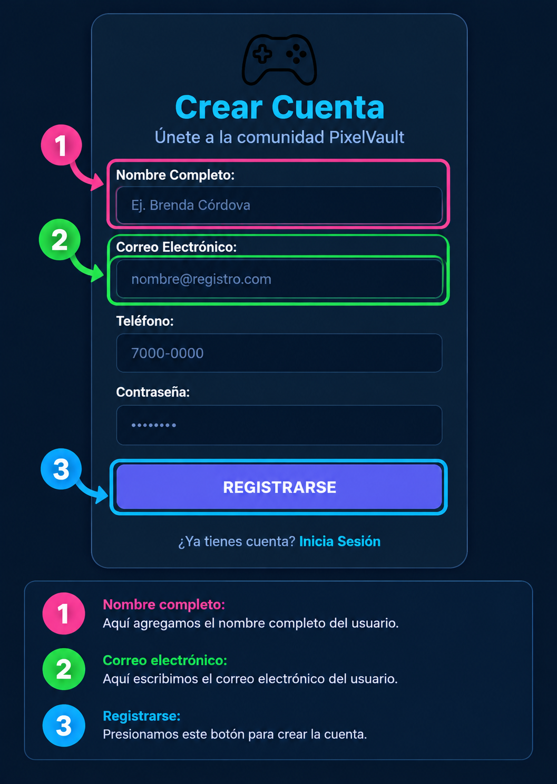

# Guía Visual de Navegación y Uso de la Aplicación

Bienvenido a la guía de uso de PixelVault Store. Este manual te explicará paso a paso cómo utilizar las funciones principales de forma rápida y sencilla.

---

## 1. Mapa General de Navegación

A continuación se muestra el recorrido visual de las pantallas dentro de la aplicación:

---

## 2. Paso a Paso: Cómo Iniciar Sesión

Para acceder a tu cuenta en la aplicación, realiza las siguientes acciones:

1. **Correo Electrónico (1):** Ingresa la dirección de correo con la que creaste tu cuenta.
2. **Contraseña (2):** Escribe tu clave de acceso personal.
3. **Botón "Ingresar" (3):** Presiona el botón para entrar a tu pantalla principal.

---

## 3. Paso a Paso: Cómo Crear una Cuenta

Para crear una cuenta nueva en PixelVault Store, realiza las siguientes acciones:

1. **Nombre Completo (1):** Agrega el nombre completo del usuario.
2. **Correo Electrónico (2):** Escribe el correo electrónico que utilizarás para la cuenta.
3. **Registrarse (3):** Presiona este botón para crear la cuenta.