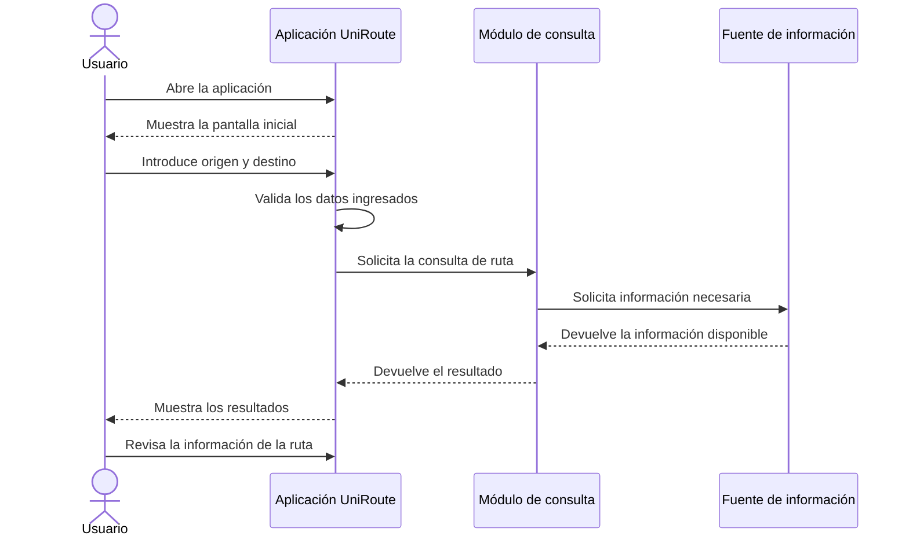

# Diagrama de Secuencia - UniRoute

## 1. Introducción

El diagrama de secuencia permite representar el orden de las interacciones entre el usuario y los componentes de UniRoute durante una consulta de rutas.

Este documento describe el flujo general desde que el usuario abre la aplicación hasta que consulta los resultados de una ruta.

## 2. Diagrama de Interacción

El siguiente diagrama representa un flujo general de consulta de rutas. Los participantes y las operaciones deberán ajustarse a los componentes reales de la aplicación.

**Nota:** El diagrama es una representación conceptual. El participante «Fuente de información» debe ajustarse a la implementación real de UniRoute. Si la aplicación no utiliza un servicio externo o un módulo independiente de consulta, el diagrama debe modificarse para reflejar su arquitectura.

## 3. Explicación del Flujo

### Paso 1: Inicio de la aplicación

El usuario abre UniRoute desde el dispositivo o entorno disponible. La aplicación carga la pantalla inicial y presenta las opciones habilitadas para su utilización.

### Paso 2: Acceso a la consulta de rutas

El usuario identifica y selecciona la opción destinada a consultar rutas, si se encuentra disponible en la versión actual de la aplicación.

### Paso 3: Selección del origen y destino

El usuario introduce o selecciona el punto de origen y el destino deseado. Antes de continuar, debe comprobar que ambos datos sean correctos.

### Paso 4: Validación de los datos

La aplicación comprueba la información ingresada de acuerdo con las validaciones implementadas. Si faltan datos o existe algún problema, debe indicarse al usuario que revise la información.

### Paso 5: Solicitud de consulta

Cuando los datos son válidos, la aplicación inicia el proceso de consulta de la ruta mediante el mecanismo definido en el proyecto.

### Paso 6: Obtención de información

El componente responsable de la consulta procesa la solicitud y obtiene la información necesaria. La fuente de estos datos depende de la arquitectura real de UniRoute.

### Paso 7: Procesamiento del resultado

La aplicación recibe y procesa la información disponible para preparar los resultados que se mostrarán al usuario.

### Paso 8: Visualización de resultados

La aplicación presenta los resultados de la consulta. El usuario revisa la información mostrada y comprueba que corresponda al origen y destino seleccionados.

### Paso 9: Finalización de la consulta

El usuario puede continuar utilizando las opciones disponibles o realizar otra consulta, si la aplicación lo permite.

## 4. Resumen del Flujo

El flujo general de consulta de rutas en UniRoute puede resumirse de la siguiente manera:

**Abrir aplicación → Acceder a la consulta → Seleccionar origen y destino → Validar datos → Solicitar consulta → Procesar información → Mostrar resultados → Revisar la ruta.**

## 5. Consideraciones Técnicas

- El diagrama representa el flujo conceptual de una consulta de rutas.
- Los participantes deben corresponder a los componentes reales del proyecto.
- La fuente de información puede ser local o externa, según la implementación.
- Las validaciones deben coincidir con las que realmente ejecuta la aplicación.
- Si se modifica el funcionamiento de UniRoute, el diagrama y su explicación deben actualizarse.
- El diagrama Mermaid requiere que la documentación tenga habilitado el soporte correspondiente para visualizarse como gráfico.

## 6. Conclusión

El diagrama de secuencia ayuda a comprender el orden de las operaciones que intervienen en una consulta de rutas en UniRoute. Su propósito es facilitar la comprensión de la interacción entre el usuario y la aplicación, así como apoyar el análisis, el mantenimiento y la documentación del proyecto.